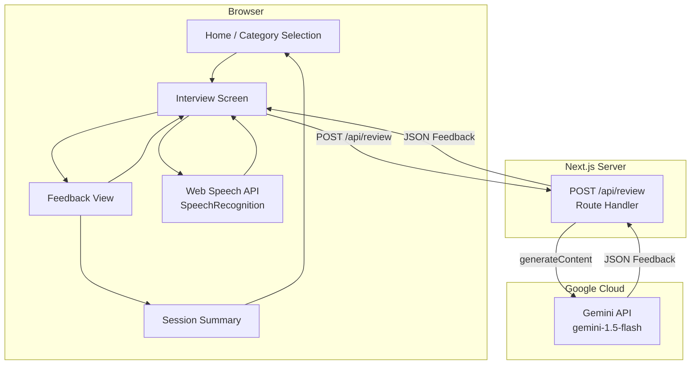

# Design Document: Mock Interview Helper

## Overview

The Mock Interview Helper is a single-page web application built with **Next.js 14 (App Router)**. Users select an interview category, answer questions by speaking into their microphone (with live speech-to-text transcription via the Web Speech API), and receive structured AI feedback powered by the Gemini API. The Gemini API key is kept exclusively on the server via a Next.js Route Handler, so it is never exposed to the browser.

### Tech Stack

| Layer | Choice | Rationale |
|---|---|---|
| Framework | Next.js 14 (App Router) | Provides both the React frontend and the server-side API route in one project; no separate backend needed |
| Language | TypeScript | Type safety across shared data models (Question, Feedback, Session) |
| Styling | Tailwind CSS | Utility-first, responsive by default, easy WCAG contrast management |
| State management | React `useState` / `useReducer` + React Context | Sufficient for a single-session SPA; no external store needed |
| Speech-to-text | Web Speech API (`SpeechRecognition`) | Browser-native, zero cost, real-time interim results |
| AI review | Google Gemini API (`gemini-1.5-flash`) | Fast, cost-effective, supports structured JSON output |
| HTTP client | `fetch` (built-in) | No extra dependency needed for the single proxy endpoint |
| Testing | Vitest + React Testing Library + fast-check | Unit/component tests + property-based tests |

### Key Design Decisions

1. **Server-side Gemini proxy** — A Next.js Route Handler at `POST /api/review` calls the Gemini API using `process.env.GEMINI_API_KEY`. The client never sees the key.
2. **Structured Gemini output** — The prompt instructs Gemini to return JSON matching the `Feedback` schema, and `responseMimeType: "application/json"` is set so the response is guaranteed to be parseable.
3. **Web Speech API with graceful degradation** — The app detects `window.SpeechRecognition` support at runtime. If unavailable (Firefox, Safari), or if the user denies microphone permission, a plain `<textarea>` fallback is shown immediately.
4. **Client-side question bank** — Interview questions are stored as a static JSON file bundled with the app. No database is needed; the question set is small and read-only.
5. **No authentication** — Sessions are ephemeral and stored only in React state. No user accounts or persistence across page reloads.

---

## Architecture



### Project Structure

```
mock-interview-app/
├── app/
│   ├── layout.tsx              # Root layout (fonts, global styles, skip-nav link)
│   ├── page.tsx                # Home screen — category selection
│   ├── interview/
│   │   └── page.tsx            # Interview screen (question + recording + feedback)
│   ├── summary/
│   │   └── page.tsx            # Session summary screen
│   └── api/
│       └── review/
│           └── route.ts        # Server-side Gemini proxy (POST)
├── components/
│   ├── CategoryCard.tsx        # Selectable category tile
│   ├── QuestionDisplay.tsx     # Renders the current question
│   ├── TranscriptArea.tsx      # Live transcription display
│   ├── RecordingControls.tsx   # Start/Stop recording buttons
│   ├── FeedbackPanel.tsx       # Score, strengths, improvements, summary
│   ├── SessionSummaryCard.tsx  # Per-question summary row
│   ├── LoadingSpinner.tsx      # Generic loading indicator
│   └── ErrorMessage.tsx        # Inline/block error display
├── hooks/
│   ├── useSpeechRecognition.ts # Encapsulates Web Speech API lifecycle
│   └── useInterviewSession.ts  # Session state machine (useReducer)
├── lib/
│   ├── questions.ts            # Question bank loader
│   ├── gemini.ts               # Server-only Gemini client wrapper
│   └── validation.ts           # Shared input validation helpers
├── data/
│   └── questions.json          # Static question bank
├── types/
│   └── index.ts                # Shared TypeScript types
├── .env.local                  # GEMINI_API_KEY (not committed)
└── next.config.ts
```

---

## Components and Interfaces

### Pages

#### `app/page.tsx` — Home / Category Selection
- Renders five `<CategoryCard>` components (one per category).
- Tracks `selectedCategory: Category | null` in local state.
- "Start Session" button navigates to `/interview?category=<slug>` via `useRouter`.
- Displays inline error if "Start" is clicked with no category selected (Req 1.4).

#### `app/interview/page.tsx` — Interview Screen
- Reads `?category` from `useSearchParams`.
- Orchestrates the session via `useInterviewSession` hook.
- Renders `<QuestionDisplay>`, `<TranscriptArea>`, `<RecordingControls>`, and `<FeedbackPanel>` conditionally based on session phase.
- Passes session results to `/summary` via `sessionStorage` on navigation.

#### `app/summary/page.tsx` — Session Summary
- Reads completed session data from `sessionStorage`.
- Renders a `<SessionSummaryCard>` for each answered question.
- Displays average score (Req 7.2) or "no answers" message (Req 7.3).
- "New Session" button navigates back to `/`.

### Reusable Components

#### `<CategoryCard>`
```typescript
interface CategoryCardProps {
  category: Category;
  selected: boolean;
  onSelect: (category: Category) => void;
}
```
Renders as a `<button>` with `aria-pressed` reflecting selection state.

#### `<QuestionDisplay>`
```typescript
interface QuestionDisplayProps {
  question: Question;
  questionNumber: number;
  totalQuestions: number;
}
```
Renders the question text in a `<h2>` with progress indicator.

#### `<TranscriptArea>`
```typescript
interface TranscriptAreaProps {
  finalTranscript: string;
  interimTranscript: string;
  fallbackMode: boolean;
  onFallbackChange: (text: string) => void;
}
```
Displays finalized text in default style and interim text in muted/italic. In fallback mode, renders a `<textarea>` instead.

#### `<RecordingControls>`
```typescript
interface RecordingControlsProps {
  isRecording: boolean;
  isSupported: boolean;
  onStart: () => void;
  onStop: () => void;
  onSubmit: () => void;
  hasTranscript: boolean;
}
```

#### `<FeedbackPanel>`
```typescript
interface FeedbackPanelProps {
  question: Question;
  answer: string;
  feedback: Feedback;
  onNext: () => void;
  onEndSession: () => void;
}
```
Score rendered at ≥1.5× body font size (Req 6.1). Empty strength/improvement lists show "None identified" (Req 6.5).

### Custom Hooks

#### `useSpeechRecognition`
Encapsulates the full `SpeechRecognition` lifecycle:
- Detects browser support on mount.
- Manages `isRecording`, `finalTranscript`, `interimTranscript` state.
- Enforces the 10-minute auto-stop timer (Req 3.7).
- Tracks retry count (up to 3) for transcription failures (Req 3.6).
- Returns `{ isSupported, isRecording, finalTranscript, interimTranscript, retryCount, error, start, stop, reset }`.

#### `useInterviewSession`
A `useReducer`-based hook managing the session state machine:

```
CATEGORY_SELECTED → RECORDING → SUBMITTED → REVIEWING → FEEDBACK_SHOWN
                                                              ↓
                                                    NEXT_QUESTION or SESSION_ENDED
```

Returns `{ phase, currentQuestion, questionIndex, sessionResults, dispatch }`.

---

## Data Models

```typescript
// types/index.ts

export type Category =
  | "Behavioral"
  | "Technical"
  | "Cultural Fit"
  | "Situational"
  | "Communication & Presence";

export interface Question {
  id: string;
  category: Category;
  text: string;
}

export interface Feedback {
  score: number;                  // 1–10
  strengths: string[];            // 1–5 items
  areasForImprovement: string[];  // 1–5 items
  summary: string;                // ≤100 words
}

export interface SessionEntry {
  question: Question;
  answer: string;
  feedback: Feedback;
}

export interface Session {
  category: Category;
  entries: SessionEntry[];
  startedAt: string;              // ISO 8601
}

// Request/response types for POST /api/review
export interface ReviewRequest {
  question: string;
  answer: string;
  category: Category;
}

export interface ReviewResponse {
  feedback: Feedback;
}

export interface ReviewErrorResponse {
  error: string;
}
```

### Question Bank (`data/questions.json`)

```json
{
  "Behavioral": [
    { "id": "b1", "text": "Tell me about a time you handled a conflict with a coworker." },
    ...
  ],
  "Technical": [...],
  "Cultural Fit": [...],
  "Situational": [...],
  "Communication & Presence": [...]
}
```

Each category contains at least 5 questions. Questions are served in order; the session ends when all questions in the category are exhausted or the user ends early.

---

## API Design

### `POST /api/review`

**Location:** `app/api/review/route.ts`  
**Access:** Server-side only. `GEMINI_API_KEY` is read from `process.env` and never returned to the client.

#### Request

```
POST /api/review
Content-Type: application/json

{
  "question": "Tell me about a time you handled conflict.",
  "answer": "In my last role, I...",
  "category": "Behavioral"
}
```

#### Validation (server-side)
- `question` must be a non-empty string.
- `answer` must be a non-empty string (client also validates, but server re-validates defensively).
- `category` must be one of the five valid values.
- Returns `400` with `{ error: "..." }` on validation failure.

#### Gemini Prompt Template

```
You are an expert interview coach evaluating a candidate's answer to an interview question.

Category: {category}
Question: {question}
Candidate's Answer: {answer}

Evaluate the answer and respond with a JSON object matching this exact schema:
{
  "score": <integer 1-10>,
  "strengths": [<1-5 strings>],
  "areasForImprovement": [<1-5 strings>],
  "summary": <string, max 100 words>
}

Be constructive, specific, and concise.
```

The Route Handler sets `responseMimeType: "application/json"` in the Gemini generation config to guarantee a parseable JSON response.

#### Response (success — 200)

```json
{
  "feedback": {
    "score": 7,
    "strengths": ["Clear STAR structure", "Specific outcome mentioned"],
    "areasForImprovement": ["Could quantify the impact", "Tone was slightly defensive"],
    "summary": "A solid answer with a clear narrative. Adding measurable outcomes would strengthen it significantly."
  }
}
```

#### Response (error — 4xx/5xx)

```json
{ "error": "Review service unavailable. Please try again." }
```

#### Timeout Handling
The Route Handler uses `AbortController` with a 15-second timeout (Req 5.5). If Gemini does not respond in time, the handler returns `504` with an error message.

#### Security
- `GEMINI_API_KEY` is only accessed in the Route Handler (server environment).
- The key is never prefixed with `NEXT_PUBLIC_` and is therefore never bundled into client JavaScript.
- Input is validated and sanitized before being interpolated into the prompt.
- The endpoint is same-origin only (Next.js default; no CORS headers added).

---

## Speech-to-Text Integration

### Web Speech API Usage

The `useSpeechRecognition` hook wraps `window.SpeechRecognition` (or `window.webkitSpeechRecognition` for Chrome):

```typescript
const recognition = new (window.SpeechRecognition ?? window.webkitSpeechRecognition)();
recognition.continuous = true;       // keep listening until stop() is called
recognition.interimResults = true;   // fire events for in-progress speech
recognition.lang = "en-US";
```

**Event handling:**
- `onresult`: Iterates `SpeechRecognitionResultList`. Results with `isFinal === true` are appended to `finalTranscript`; the latest non-final result updates `interimTranscript`.
- `onerror`: Maps error codes (`not-allowed`, `no-speech`, `audio-capture`, `network`) to user-friendly messages and triggers the retry/fallback logic.
- `onend`: If recording was not intentionally stopped, auto-restarts (handles Chrome's 60-second continuous recognition limit).

### Transcript State

```
finalTranscript:   "I handled the conflict by first listening carefully."
interimTranscript: "Then I proposed a solution"   ← italic/muted in UI
```

When the user stops recording, `interimTranscript` is appended to `finalTranscript` to form the complete `answer`.

### Browser Support and Fallback

| Browser | Support |
|---|---|
| Chrome 33+ | Full support (`webkitSpeechRecognition`) |
| Edge 79+ | Full support |
| Safari 14.1+ | Partial (no `continuous` mode; hook restarts on `onend`) |
| Firefox | Not supported → text fallback shown immediately |

**Fallback trigger conditions (Req 3.5, 5.5):**
1. `window.SpeechRecognition` and `window.webkitSpeechRecognition` are both undefined.
2. `onerror` fires with `error.error === "not-allowed"` (permission denied).
3. Three consecutive transcription failures with no output (Req 3.6).

When any condition is met, `<TranscriptArea>` switches to a `<textarea>` and `<RecordingControls>` hides the microphone buttons.

### 10-Minute Auto-Stop (Req 3.7)

```typescript
const MAX_RECORDING_MS = 10 * 60 * 1000;
const timer = setTimeout(() => {
  recognition.stop();
  setAutoStopped(true);
}, MAX_RECORDING_MS);
```

A toast/banner notifies the user that the maximum duration was reached.

---

## State Management Approach

State is managed at two levels:

### 1. Session State (`useInterviewSession` — `useReducer`)

Manages the overall interview flow. The reducer handles these actions:

| Action | Description |
|---|---|
| `START_SESSION` | Sets category, loads questions, moves to first question |
| `START_RECORDING` | Transitions phase to `RECORDING` |
| `STOP_RECORDING` | Finalizes answer, transitions to `SUBMITTED` |
| `SUBMIT_ANSWER` | Triggers API call, transitions to `REVIEWING` |
| `RECEIVE_FEEDBACK` | Stores feedback, transitions to `FEEDBACK_SHOWN` |
| `NEXT_QUESTION` | Advances index or ends session |
| `END_SESSION` | Navigates to summary |
| `SET_ERROR` | Stores error message for display |
| `RETRY_SUBMIT` | Clears error, re-triggers submission |

### 2. Component-Local State

- `CategoryCard`: `selected` is lifted to the Home page.
- `TranscriptArea`: `fallbackText` is local to the component, surfaced via `onFallbackChange`.
- `FeedbackPanel`: Stateless — receives all data as props.

### Data Flow Diagram

```mermaid
graph LR
    useInterviewSession -->|phase, question, feedback| InterviewPage
    useSpeechRecognition -->|transcript, isRecording| InterviewPage
    InterviewPage -->|answer, question, category| POST_api_review[POST /api/review]
    POST_api_review -->|Feedback| InterviewPage
    InterviewPage -->|SessionEntry[]| sessionStorage
    sessionStorage -->|SessionEntry[]| SummaryPage
```

---

## Error Handling Strategy

| Error Scenario | Detection | User-Facing Response |
|---|---|---|
| No category selected (Req 1.4) | Client validation on submit | Inline error below category grid |
| Microphone permission denied (Req 1.5, 3.5) | `onerror: not-allowed` | Error banner + text fallback |
| Browser no mic support (Req 3.5) | Feature detection on mount | Text fallback shown immediately |
| STT produces no output after 3 retries (Req 3.6) | Retry counter in hook | Error message + text fallback |
| 10-min recording limit (Req 3.7) | `setTimeout` in hook | Toast notification, recording stopped |
| Empty answer submission (Req 5.8) | Client validation | Inline validation message, no API call |
| Gemini API timeout >15s (Req 5.5) | `AbortController` in Route Handler | Error message + "Resubmit" button |
| Gemini API error response (Req 5.5) | Non-2xx HTTP status | Error message + "Resubmit" button |
| Gemini returns malformed JSON | `JSON.parse` try/catch in Route Handler | 502 error → client shows retry |
| Network failure (fetch throws) | `try/catch` around `fetch` | Error message + "Resubmit" button |

### Error Display Rules
- **Inline errors** (validation): Rendered adjacent to the relevant control, associated via `aria-describedby`.
- **Block errors** (API/mic failures): Rendered in a visually distinct `role="alert"` region so screen readers announce them immediately.
- **Resubmit option**: Only shown when Feedback has NOT been successfully received (Req 5.6).

---

## Accessibility Implementation Notes

### WCAG 2.1 Level AA Compliance (Req 8.2)

- Tailwind's color palette is chosen to meet 4.5:1 contrast for normal text and 3:1 for large text and UI components.
- All interactive elements use Tailwind's `focus-visible:ring-2 focus-visible:ring-offset-2` utilities to produce a visible 2px+ focus ring with ≥3:1 contrast (Req 8.4).

### Accessible Names (Req 8.3)

| Element | Accessible Name Strategy |
|---|---|
| Category cards | Visible text label inside `<button>` |
| Start/Stop Recording | Visible button text + `aria-label` when icon-only |
| Score display | `<h3>Score: {n}/10</h3>` — visible and semantic |
| Transcript area | `<label>` associated via `htmlFor` / `aria-labelledby` |
| Error messages | `role="alert"` + descriptive text |
| Loading spinner | `role="status"` + `aria-label="Loading feedback…"` |

### Keyboard Navigation (Req 8.4)

- All interactive elements are native `<button>` or `<a>` elements — keyboard focusable by default.
- Tab order follows visual reading order (top-to-bottom, left-to-right).
- A "Skip to main content" link is the first focusable element in `layout.tsx`.
- Modal-like feedback panels trap focus within the panel while visible.

### Responsive Layout (Req 8.1)

- Minimum supported width: 320px.
- Category grid: `grid-cols-1` on mobile, `grid-cols-2 sm:grid-cols-3` on tablet+.
- Transcript area: full-width, scrollable, min-height 120px.
- Feedback panel: single-column stack on mobile, two-column (strengths | improvements) on desktop.
- No fixed-width elements; all widths use `max-w-*` with `w-full`.

### Screen Reader Announcements

- Phase transitions (e.g., "Feedback received", "Recording stopped") are announced via a visually-hidden `aria-live="polite"` region.
- The 10-minute auto-stop notification uses `aria-live="assertive"` to interrupt immediately.

---

## Correctness Properties

*A property is a characteristic or behavior that should hold true across all valid executions of a system — essentially, a formal statement about what the system should do. Properties serve as the bridge between human-readable specifications and machine-verifiable correctness guarantees.*

### Property 1: Valid answer submission always produces a schema-conformant Feedback object

*For any* non-empty question string, non-empty answer string, and valid category, the `/api/review` route handler SHALL return a response whose body parses to a `Feedback` object where: `score` is an integer in [1, 10]; `strengths` is an array of 1–5 non-empty strings; `areasForImprovement` is an array of 1–5 non-empty strings; and `summary` is a string whose word count does not exceed 100. Furthermore, when such a valid Feedback is present in the session state, the resubmit control SHALL NOT be rendered.

**Validates: Requirements 5.2, 5.6, 5.7**

---

### Property 2: Empty or whitespace-only answers are always rejected without an API call

*For any* string composed entirely of whitespace characters (including the empty string), calling the answer-submission handler SHALL produce a validation error, leave the session state unchanged, and make zero calls to `/api/review`.

**Validates: Requirements 5.8**

---

### Property 3: Session average score equals the arithmetic mean of entry scores rounded to one decimal place

*For any* non-empty list of `SessionEntry` values each carrying a `feedback.score` in [1, 10], the value displayed as the average score SHALL equal `Math.round((sum / count) * 10) / 10` — i.e., the true arithmetic mean rounded to one decimal place.

**Validates: Requirements 7.2**

---

### Property 4: Final transcript accumulation is strictly append-only

*For any* ordered sequence of `SpeechRecognitionResult`-shaped events where each result has `isFinal: true`, the `finalTranscript` produced by the `useSpeechRecognition` hook after processing the full sequence SHALL equal the concatenation of each result's transcript string in the order the events were received, with no characters dropped, duplicated, or reordered.

**Validates: Requirements 3.3, 4.2**

---

### Property 5: FeedbackPanel always renders all required sections for any Feedback value

*For any* `Feedback` object — including those where `strengths` and/or `areasForImprovement` are empty arrays — the rendered `<FeedbackPanel>` SHALL contain: a score element rendered before all other content; a labeled strengths section; a labeled areas-for-improvement section; and a summary paragraph. When either list is empty, the corresponding section SHALL display "None identified" rather than being omitted.

**Validates: Requirements 6.1, 6.3, 6.4, 6.5**

---

### Property 6: All interactive elements have a non-empty accessible name

*For any* rendered page in the application, every element matching the ARIA role of `button`, `link`, `textbox`, `combobox`, or `checkbox` SHALL have a non-empty accessible name derivable from its visible label text, `aria-label`, or `aria-labelledby` attribute.

**Validates: Requirements 8.3**

---

## Testing Strategy

### Unit and Component Tests (Vitest + React Testing Library)

- **`lib/validation.ts`**: Example-based tests for each validation rule (empty string, whitespace-only, invalid category, oversized input).
- **`lib/gemini.ts`**: Mock-based tests verifying the prompt template is constructed correctly for all five categories.
- **`hooks/useSpeechRecognition`**: Tests for state transitions (start → recording → stop → finalized), error handling, retry logic, and auto-stop timer using fake timers.
- **`hooks/useInterviewSession`**: Reducer unit tests for every action type; verifies state machine transitions.
- **`components/FeedbackPanel`**: Renders with empty `strengths`/`areasForImprovement` arrays and asserts "None identified" is present; verifies score font size class.
- **`components/TranscriptArea`**: Verifies interim text has muted/italic styling; verifies fallback `<textarea>` renders when `fallbackMode=true`.
- **`app/api/review/route.ts`**: Integration tests using `msw` to mock the Gemini API; verifies 400 on invalid input, 504 on timeout, 200 with valid Feedback shape.

### Property-Based Tests (Vitest + fast-check)

Each property test runs a minimum of **100 iterations**. Tests are tagged with the format:  
`// Feature: mock-interview-helper, Property {N}: {property_text}`

- **Property 1** — Generate arbitrary non-empty question/answer/category triples; mock the Gemini client to return a valid `Feedback`; assert the parsed response always satisfies the `Feedback` schema constraints (score in [1,10], array lengths, word count). Also assert that when Feedback is present in state, the resubmit button is absent from the rendered output.
- **Property 2** — Generate arbitrary whitespace-only strings (spaces, tabs, newlines, Unicode whitespace, combinations); assert `validateAnswer()` returns an error, the session reducer state is unchanged, and `fetch` is never called.
- **Property 3** — Generate arbitrary non-empty arrays of `SessionEntry` with random integer scores in [1, 10]; assert `calculateAverageScore()` returns `Math.round((sum / count) * 10) / 10`.
- **Property 4** — Generate arbitrary sequences of `SpeechRecognitionResult`-shaped objects with `isFinal: true`; feed them through the transcript accumulation logic in `useSpeechRecognition`; assert the output equals the exact concatenation of all transcript strings in order.
- **Property 5** — Generate arbitrary `Feedback` objects including those with empty `strengths` and/or `areasForImprovement` arrays; render `<FeedbackPanel>` with React Testing Library; assert score, both labeled list sections, and summary paragraph are all present, and that empty arrays produce "None identified".
- **Property 6** — For each page component (Home, Interview, Summary), render it with arbitrary valid props; query all interactive ARIA roles; assert every element has a non-empty accessible name.

### Integration Tests

- End-to-end flow (Playwright): Category selection → question display → text fallback answer → feedback display → session summary with correct average.
- Microphone permission denial: Verify text fallback appears and recording controls are hidden.
- Gemini timeout: Mock a slow response; verify the "Resubmit" button appears after 15 seconds.

### Accessibility Tests

- `axe-core` (via `@axe-core/react`) run on each page in CI to catch WCAG violations automatically.
- Manual keyboard navigation walkthrough documented in the test plan.
- Color contrast verified with Tailwind's configured palette against WCAG AA thresholds.
